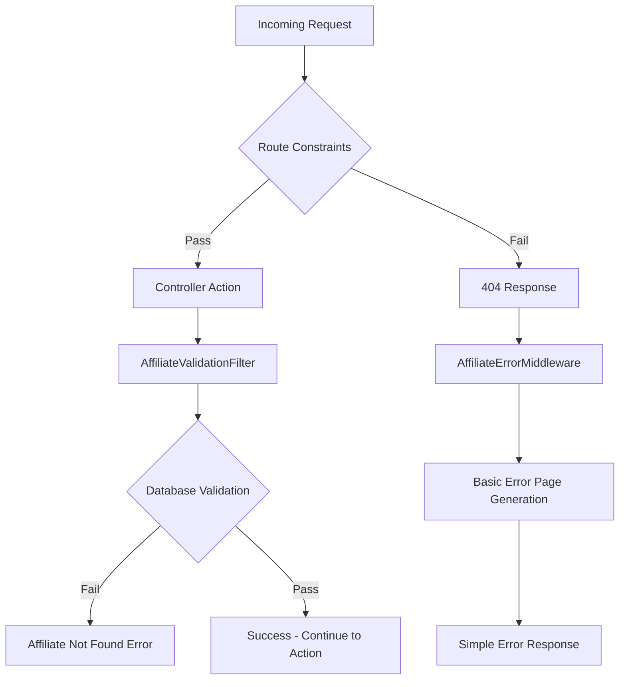

# Fanex Affiliate Link System - Architecture Overview

## Table of Contents
- [System Overview](#system-overview)
- [Architecture Layers](#architecture-layers)
- [Component Architecture](#component-architecture)
- [Validation Flow](#validation-flow)
- [Key Design Patterns](#key-design-patterns)
- [Performance Optimizations](#performance-optimizations)
- [Technology Stack](#technology-stack)
- [Extensibility & Maintenance](#extensibility--maintenance)
- [Monitoring & Analytics](#monitoring--analytics)

## System Overview

The Fanex Affiliate Link System is a streamlined, performance-focused validation system designed to handle affiliate marketing URLs with efficient routing, basic error handling, and database validation.

### Core Objectives
- **Performance**: Fast route matching with early invalid URL filtering
- **Simplicity**: Clean, maintainable validation logic focused on core business needs
- **Reliability**: Robust database validation for affiliate verification
- **Scalability**: Efficient validation with minimal overhead
- **Analytics**: Essential logging for business intelligence

## Architecture Layers

The system implements a **Simplified Validation Architecture** with three focused layers:

```
┌─────────────────────────────────────────────────────────────┐
│                    LAYER 1: Route Constraints               │
│                   (Fast Pattern Filtering)                  │
├─────────────────────────────────────────────────────────────┤
│                 LAYER 2: Error Middleware                   │
│                (Basic Error Page Generation)                │
├─────────────────────────────────────────────────────────────┤
│                LAYER 3: Validation Filters                  │
│              (Database Validation Only)                     │
└─────────────────────────────────────────────────────────────┘
```

### Layer 1: Route Constraints
- **Purpose**: Fast, basic pattern matching to filter obviously invalid URLs
- **Technology**: ASP.NET Core Route Constraints with RegexPatterns
- **Performance**: Microsecond-level filtering at routing level
- **Scope**: Numeric patterns, language codes, page code structures

### Layer 2: Error Middleware  
- **Purpose**: Catch 404s and provide basic error pages for affiliate links
- **Technology**: Custom ASP.NET Core Middleware with simple HTML generation
- **Performance**: Only runs on failed routes (404 responses)
- **Scope**: Basic error page generation with consistent messaging

### Layer 3: Validation Filters
- **Purpose**: Database validation for affiliate verification
- **Technology**: ASP.NET Core Action Filters with dependency injection
- **Performance**: Only runs for successfully routed requests
- **Scope**: Database validation for affiliate ID/code existence

## Component Architecture

### Core Components

#### 1. Constants Layer
```
Constants/
├── RouteConstraints.cs      # Centralized routing patterns
├── RegexPatterns.cs         # GeneratedRegex for performance
├── Language.cs              # Supported language definitions
└── LandingPage.cs          # Page code mappings
```

**Key Features:**
- **Centralized Patterns**: Single source of truth for all validation rules
- **GeneratedRegex**: Compile-time optimization for regex patterns
- **Dynamic Generation**: Language patterns generated from constants

#### 2. Validation Layer
```
Middleware/
├── AffiliateErrorMiddleware.cs    # 404 error handling & basic error pages
Filters/
├── AffiliateValidationFilter.cs   # Database validation for affiliates
```

**Key Features:**
- **Clean Architecture**: Separation between basic error handling and database validation
- **Simplified Logic**: Focused on essential affiliate verification
- **Dependency Injection**: Testable, maintainable component design

#### 3. Service Layer
```
Services/
├── Interface/
│   ├── IAffInfoService.cs         # Affiliate data access contract
│   └── IMemoryCacheService.cs     # Caching service contract
└── Impl/
    ├── AffInfoService.cs          # Affiliate data implementation
    └── MemoryCacheService.cs      # Caching implementation
```

#### 4. Examples & Documentation
```
Examples/
├── RouteConstraintExamples.cs     # Route constraint demonstrations
├── HybridApproachExamples.cs      # Architecture workflow examples
└── MiddlewareTestExamples.cs      # Middleware test scenarios
```

## Validation Flow

### 1. Request Processing Flow


### 2. URL Pattern Recognition
The system supports multiple URL patterns with intelligent detection:

#### Basic Links (3 segments)
- **Modern**: `pageCode/affCode/lang/index.html`
- **Legacy**: `affId/pageCode/lang/index.html`
- **Detection**: First segment numeric → Legacy, otherwise Modern

#### Channel Links (4 segments)  
- **Channel**: `pageCode/affCode/lang/channel/index.html`
- **Special**: `affId/pageCodePart1/pageCodePart2/lang/index.html`
- **Detection**: First segment numeric → Special, otherwise Channel

#### Complex Links (5 segments)
- **Pattern**: `pageCodePart1/pageCodePart2/affCode/lang/channel/index.html`

### 3. Validation Hierarchy
```
Route Constraints (Basic Patterns)
├── Numeric validation (^\d+$)
├── Language pattern (dynamic from constants)
├── Page code pattern (^[a-zA-Z0-9/_-]+$)
└── Channel pattern (^[a-zA-Z0-9_-]+$)

Error Middleware (Basic Error Handling)
├── 404 detection for affiliate links
├── Simple error page generation
└── Basic error logging

Validation Filter (Database Validation)
├── Affiliate ID existence checks
├── Affiliate code existence checks
└── Basic error response generation
```

## Key Design Patterns

### 1. Simplified Validation Pattern
**Problem**: Balance between performance and validation complexity
**Solution**: Layered validation focusing on core business needs
**Benefits**: Fast filtering + essential database validation + maintainable code

### 2. Centralized Patterns Pattern
**Problem**: Regex duplication across components
**Solution**: `RegexPatterns` class with `GeneratedRegex`
**Benefits**: Single source of truth + compile-time optimization

### 3. Database-First Validation
**Problem**: Complex pattern validation maintenance overhead
**Solution**: Focus on database validation for affiliate verification
**Benefits**: Simplified logic + reliable business validation

### 4. Extension Method Pattern
**Problem**: Repetitive route configuration code
**Solution**: `MapAffiliateRoutes()` extension method with centralized configuration
**Benefits**: DRY principle + consistent route setup

### 5. Tuple Deconstruction Pattern
**Problem**: Multiple array access for URL segments
**Solution**: `var (pageCode, affCode, lang) = (segments[0], segments[1], segments[2])`
**Benefits**: Cleaner, more readable code

## Performance Optimizations

### 1. GeneratedRegex
- **Technology**: .NET 7+ `GeneratedRegexAttribute`
- **Benefit**: Compile-time regex compilation
- **Impact**: 2-3x faster regex matching

### 2. Early Filtering
- **Strategy**: Route constraints filter invalid URLs before expensive processing
- **Benefit**: Minimal overhead on invalid requests
- **Impact**: Microsecond-level rejection of bad URLs

### 3. Database Validation Only for Valid Routes
- **Strategy**: Database calls only for successfully routed requests
- **Benefit**: Reduced database load on invalid URLs
- **Impact**: Database validation only when needed

### 4. Centralized Pattern Compilation
- **Strategy**: Compile regex patterns once, reuse across components
- **Benefit**: Reduced initialization overhead
- **Impact**: Better memory usage and startup performance

### 5. Simplified Error Handling
- **Strategy**: Basic error pages instead of complex analysis
- **Benefit**: Reduced processing overhead on 404s
- **Impact**: Faster error responses with minimal resource usage

## Technology Stack

### Core Framework
- **ASP.NET Core 9.0**: Web application framework
- **C# 12**: Programming language with modern features
- **.NET 9**: Runtime platform

### Key Technologies
- **GeneratedRegex**: Compile-time regex optimization
- **Route Constraints**: ASP.NET Core routing system
- **Action Filters**: Request pipeline customization
- **Middleware**: Custom request processing
- **Dependency Injection**: Built-in IoC container

### Data Access
- **Entity Framework Core**: ORM for database operations
- **SQL Server**: Database platform
- **Memory Caching**: In-memory caching for performance

### Logging & Monitoring
- **ILogger**: Built-in logging framework
- **Structured Logging**: Detailed analytics support
- **Performance Counters**: Custom metrics collection

## Extensibility & Maintenance

### Adding New Validation Rules

#### 1. Route Constraint Changes
```csharp
// Add to RegexPatterns.cs
[GeneratedRegex(@"^new-pattern$", RegexOptions.Compiled)]
public static partial Regex NewPattern();

// Update RouteConstraints.cs
public const string NewPatternRegex = @"^new-pattern$";

// Update RouteExtensions.cs
constraints: new
{
    newField = RouteConstraints.NewPattern
}
```

#### 2. Database Validation Changes
```csharp
// Add to AffiliateValidationFilter.cs
private AffiliateValidationResult ValidateNewBusinessRule(IDictionary<string, object> parameters)
{
    // Database validation implementation
}

// Add to validation chain
return ValidateAffiliateById(parameters)
    ?? ValidateAffiliateByCode(parameters)
    ?? ValidateNewBusinessRule(parameters);  // New rule
```

#### 3. Basic Error Handling Changes
```csharp
// Update AffiliateErrorMiddleware.cs for new error types
private const string NewErrorMessage = "This link format is not supported.";

// Update error analysis if needed
return segments.Length switch
{
    6 => ValidateNewPattern(segments),  // New pattern
    5 => ValidateSpecialPageCodeChannelPattern(segments),
    // ... existing patterns
};
```

### Configuration Options
- **Environment-specific validation**: Toggle validation layers per environment
- **Error message verbosity**: Adjust basic error message content
- **Validation timeouts**: Configure database validation timeouts
- **Route constraint patterns**: Modify basic pattern matching rules

### Testing Strategy
- **Unit Tests**: Each validation layer tested independently
- **Integration Tests**: End-to-end validation scenarios
- **Performance Tests**: Route constraint and filter performance
- **Load Tests**: Database validation under load

## Monitoring & Analytics

### Key Metrics
- **Route Constraint Performance**: Filtering speed and rejection rates
- **Middleware Error Response**: 404 handling and error page generation
- **Database Validation Success**: Affiliate lookup success rates
- **Database Performance**: Query timing and connection health

### Analytics Capabilities
- **URL Pattern Analysis**: Most common valid and invalid patterns
- **Affiliate Usage Tracking**: Active vs inactive affiliate requests
- **Error Rate Monitoring**: 404 trends and affiliate lookup failures
- **Performance Monitoring**: Response times across validation layers

### Alerting Framework
- **High Error Rates**: Spike detection for 404s and database failures
- **Performance Degradation**: Response time threshold monitoring
- **Database Issues**: Connection and timeout monitoring
- **Traffic Pattern Changes**: Unusual request volume detection

## Conclusion

The Fanex Affiliate Link System represents a streamlined, production-ready architecture that successfully balances performance, simplicity, and reliability. The simplified validation approach ensures optimal performance while focusing on essential business validation.

Key architectural strengths:
- **Performance-First Design**: Early filtering and compile-time optimizations
- **Simplified Architecture**: Clean separation of concerns with minimal complexity
- **Maintainability**: Centralized patterns and focused validation logic
- **Reliability**: Database-focused validation for core business requirements
- **Extensibility**: Easy to add new route constraints and database validations

This architecture serves as a blueprint for efficient, maintainable validation systems in affiliate marketing domains where performance and simplicity are prioritized over complex validation features. 